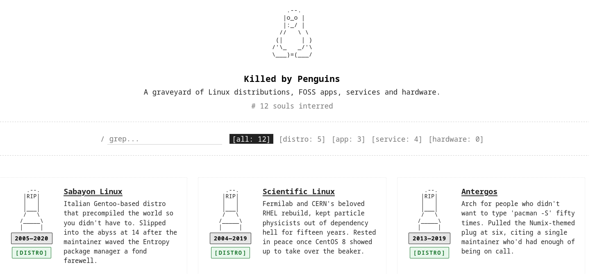

# Killed by Penguins

A minimalist memorial site for Linux distributions, FOSS apps, services, and
hardware that have been discontinued, abandoned, or otherwise unceremoniously
killed.



Inspired by [Killed By Google](https://killedbygoogle.com/), with more penguins
and fewer quarterly earnings calls.

## Run it

It's a static site. Either open `index.html` in a browser, or serve the folder
over HTTP (recommended, so `fetch('graveyard.json')` works):

```sh
python3 -m http.server 8000
# then open http://localhost:8000
```

## File layout

```
killed-by-penguins/
├── index.html        # markup + pre-rendered entries
├── styles.css        # terminal/skeleton styling, fully responsive
├── script.js         # search, filter, dynamic re-render
├── build.js          # pre-renders graveyard.json into index.html
├── graveyard.json    # the data — add entries here
└── README.md         # this file
```

## How it works

- `index.html` ships with all entries pre-rendered into the `<ul>` by `build.js`,
  so the page works in TUI browsers (w3m, lynx, links) and with JavaScript
  disabled.
- `script.js` enhances the static page: it fetches `graveyard.json` (to get
  fresh "X years ago" tooltips), wires up search and filter, and falls back
  gracefully if the fetch fails.
- `styles.css` is a single stylesheet with dark default + light via
  `prefers-color-scheme`, and breakpoints for phones, tablets, and wide screens.

Search is performed by hand on the rendered DOM via `dataset.name` /
`dataset.desc`, so it works on anything you can see on screen (no fuzzy logic,
no ranking — keep it predictable).

## Build step

After editing `graveyard.json`, run:

```sh
node build.js
```

This regenerates the static HTML inside `index.html`. The pre-rendered content
is what TUI/no-JS clients see; the live page script replaces it on load so
JS-enabled clients get search/filter.

## Add a casualty

Entries live in `graveyard.json` as a flat array. Submit a PR that appends
a new object. Schema:

```jsonc
{
  "name": "Project Name",
  "category": "distribution | app | service | hardware",
  "openDate": "YYYY-MM-DD",       // optional but encouraged
  "deathDate": "YYYY-MM-DD",      // first of the month is fine
  "description": "Short, droll mortem. 1–2 sentences.",
  "link": "https://en.wikipedia.org/wiki/Project"  // optional
}
```

Please keep tone consistent with the existing entries — somber but gently
sardonic. We're a graveyard, not a court.

## Categories

The category list is hard-coded in `script.js` (`CATEGORIES`). If you add a new
category, add it there too — the color and label are defined in `styles.css`
under `.entry[data-category="your-category"] .tombstone-category`.

## Credits

- Aesthetic inspiration: [Killed By Google](https://killedbygoogle.com/).
- Mascot: Tux, the Linux penguin, who has never killed anything (that we know of).
